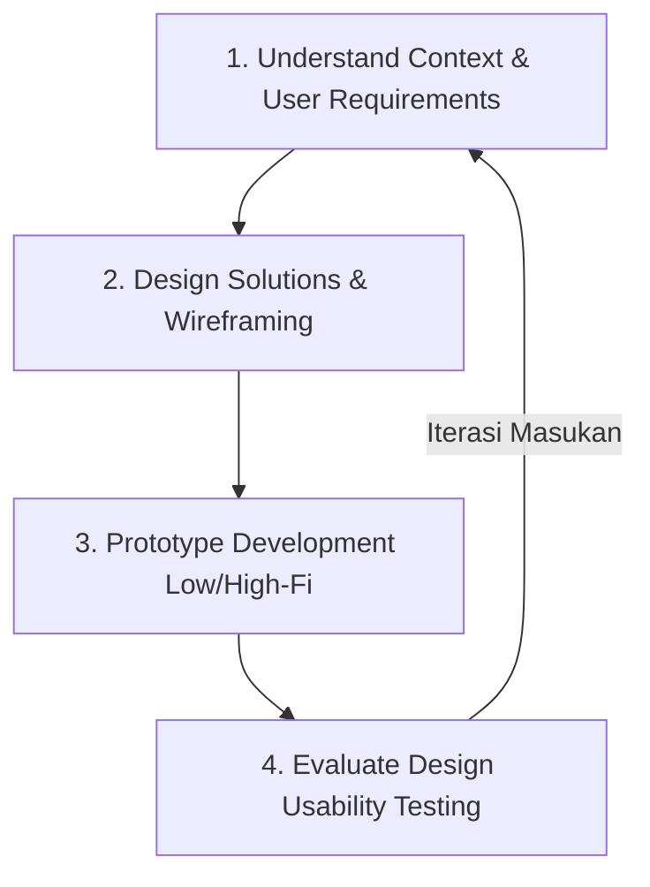

> **Materi:** *"Human-Computer Interaction & Data Visualization"*  
> **Narasumber:** Dr. Arafat Febriandirza (Kepala Kelompok Riset IMK & Visualisasi Data, Pusat Riset Sains Data dan Informasi - BRIN)  
> **Penyelenggara:** Informatics Practitioner Lecture Series Program Studi Informatika, Universitas Bengkulu  
> **Tautan Video Webinar:** [YouTube Live - Informatics Practitioner Lecture Series](https://www.youtube.com/live/5KhQm8OaYRM?si=tNw55m7zsHYNI-AF)

---

## 📌 Ringkasan Studi Kasus

Pengembangan sistem antarmuka modern memerlukan keseimbangan antara nilai estetika, fungsionalitas sistem, dan psikologi kognitif otak manusia dalam mencerna informasi visual. Penerapan **User-Centered Design (UCD)** memastikan antarmuka dirancang bukan berdasarkan persepsi perancang (*You are not your user*), melainkan berorientasi penuh pada kebutuhan nyata *user persona*.

### **Pertanyaan Utama & Kebutuhan Operasional**
> *"Bagaimana merancang antarmuka visualisasi data yang intuitif, bebas dari chartjunk, meminimalkan beban kognitif (extraneous cognitive load), serta memenuhi 10 Prinsip Evaluasi Heuristic Jacob Nielsen?"*

### **Solusi IMK & Visualisasi Data**
Mengombinasikan prinsip **Gestalt Psychology**, **Preattentive Attributes**, serta Taksonomi Interaksi Visual Ben Shneiderman (*Overview first, zoom and filter, then details-on-demand*) dalam sebuah dashboard analitik interaktif.

---

## 🔄 Metodologi User-Centered Design (UCD) Iteratif

Pengembangan sistem ini mengikuti 4 tahapan siklus UCD yang bersifat berulang (*iterative*):

1. **Understand Context & User Requirements:** Mengidentifikasi karakteristik *User Persona* (Profil, Goals, Pain Points, dan Behavior).
2. **Design Solutions & Wireframing:** Menyusun tata letak (*layout*) berdasar Hukum Gestalt (*Proximity, Similarity, Closure, Continual*).
3. **Prototype Development:** Membuat prototipe cepat (*Low-Fidelity* hingga *High-Fidelity*) dengan prinsip *Fail Early, Fail Cheap*.
4. **Evaluate Design:** Melakukan pengujian keterpakaian melalui *Expert Inspection (Heuristic Evaluation)* dan *Usability Testing*.

---

## 📈 4 Level Tingkatan Analytics

| Level Analytics | Pertanyaan Utama | Hasil / Implementasi pada Kasus |
| :--- | :--- | :--- |
| **Descriptive** | *Apa yang terjadi?* | Pengukuran metrik *Task Completion Time*, *Error Rate*, dan skor kepuasan *System Usability Scale (SUS)*. |
| **Diagnostic** | *Mengapa ini terjadi?* | Analisis menemukan modul "Pengaturan Sistem" memiliki *extraneous load* tinggi akibat navigasi yang rumit dan tata letak tidak konsisten. |
| **Predictive** | *Apa yang akan terjadi?* | Pemodelan tren memprediksi reduksi *task time* hingga **45%** setelah penataan ulang hirarki visual. |
| **Prescriptive** | *Apa tindakan terbaik?* | Menerapkan 10 Prinsip Heuristic Nielsen (terutama *Error Prevention* dan *Recognition over Recall*) pada antarmuka dashboard. |

---

## 📊 Evaluasi 10 Heuristic Nielsen pada Dashboard

| No | Prinsip Heuristic (Jacob Nielsen) | Status Evaluasi | Catatan Perbaikan Antarmuka |
| :-: | :--- | :---: | :--- |
| 1 | **Visibility of System Status** | PASS | Menampilkan *loading bar* dan indikator status waktu nyata. |
| 2 | **Match between System & Real World** | PASS | Menggunakan ikon dan istilah bisnis yang familiar bagi pengguna. |
| 3 | **User Control & Freedom** | PASS | Menyediakan tombol *Undo*, *Cancel*, dan navigasi kembali yang jelas. |
| 4 | **Consistency & Standards** | PASS | Penempatan posisi tombol aksi dan warna aksen konsisten di seluruh modul. |
| 5 | **Error Prevention** | PASS | Menggunakan konfirmasi pop-up sebelum eksekusi aksi pembatalan data. |
| 6 | **Recognition Rather than Recall** | PASS | Menampilkan menu opsi *dropdown* tanpa memaksa pengguna mengingat kode. |
| 7 | **Flexibility & Efficiency of Use** | PASS | Fitur *Keyboard Shortcuts* dan penyesuaian filter cepat bagi pengembang. |
| 8 | **Aesthetic & Minimalist Design** | PASS | Menghapus efek 3D berlebihan (*chartjunk*) dan mengoptimalkan *Data-Ink Ratio*. |
| 9 | **Help Users Recognize & Recover from Errors** | PASS | Pesan eror menggunakan bahasa manusia yang jelas tanpa kode teknis rumit. |
| 10 | **Help & Documentation** | PASS | Menyediakan bilah pencarian *Pusat Bantuan (Help Center)* dan *FAQ*. |

---

## 💡 Rekomendasi Desain & Etika Antarmuka

1. **Penerapan Taksonomi Shneiderman:** Menyajikan tampilan makro (*Overview*) di tingkat atas dashboard, diikuti fitur *Zoom/Filter*, serta rincian angka saat kursor di-hover (*Details-on-demand*).
2. **Penerapan Ethical Design:** Menghindari praktik *Dark Patterns* (seperti jebakan pembatalan langganan tersembunyi) dan menyajikan skala grafik data yang jujur tanpa manipulasi visual.
3. **Aksesibilitas Disabilitas:** Memenuhi standar kontras warna *WCAG*, navigasi penuh tanpa mouse (*keyboard operable*), serta dukungan *screen reader*.
